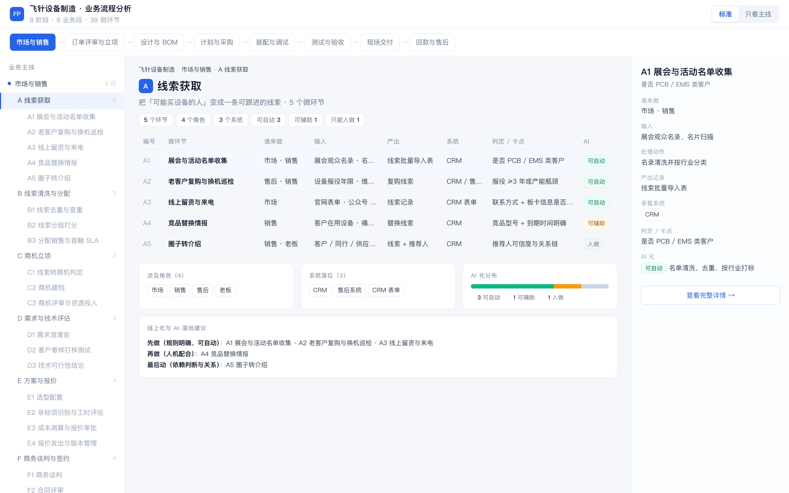
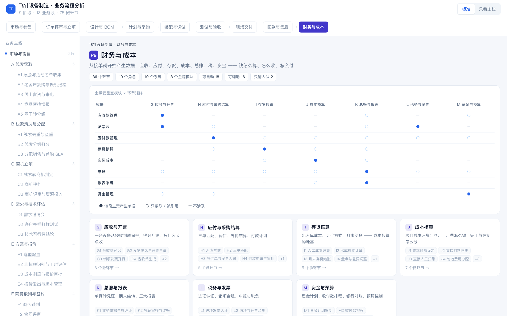
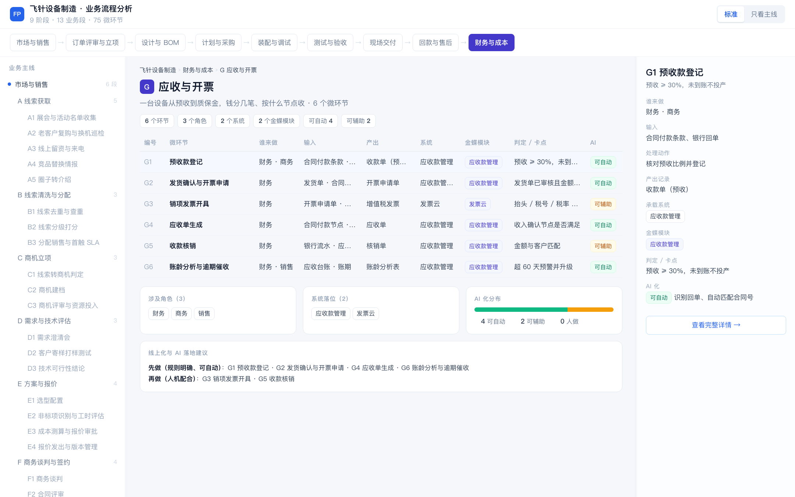

# 飞针设备制造 · 业务流程分析

把一家自动化设备公司（飞针测试机）的**全线业务**拆到「可核对的操作级」，做成可交互网页。
面向 **IT 项目管理 / 业务分析** 岗位的作品集：讲的不是流程图，而是"谁在哪个系统里做什么、产出什么记录、哪里会断、哪里能被系统或 AI 替掉"。

**在线看：https://deruienjie.github.io/flying-probe-business-process/**



## 现在到哪了

| 部分 | 状态 | 说明 |
|---|---|---|
| 全线业务骨架 | ✅ | 9 个阶段：销售 → 订单评审 → 设计/BOM → 计划采购 → 装配调试 → 测试验收 → 现场交付 → 回款售后 → **财务与成本** |
| P1 市场与销售 | ✅ 拆到微环节 | 6 个业务段（A–F）、22 个微环节，每个 7 属性 |
| P9 财务与成本 | ✅ 拆到微环节 | 7 个业务段（G–M）、36 个微环节，按金蝶云星空模块组织，含模块矩阵视图 |
| P2–P8 | 🚧 只有环节级 | 17 个环节，未拆到微环节 |
| 网页（可交互） | ✅ | 阶段 → 段 → 微环节三层；表格 + 抽屉 + 详情页 |
| 设计规范 | ✅ 大部分 | 字阶/圆角/色板/对比度/焦点环/减少动效 |
| 部署 | ✅ | GitHub Pages：https://deruienjie.github.io/flying-probe-business-process/ |

## 怎么打开

线上：**https://deruienjie.github.io/flying-probe-business-process/**（GitHub Pages）

本地：

```bash
git clone https://github.com/deruienjie/flying-probe-business-process.git
cd flying-probe-business-process
open index.html      # 纯静态，无需安装任何依赖
```

## 目录

```
index.html           入口（GitHub Pages 根目录）
styles.css           设计令牌 + 组件样式
app.js               渲染层：阶段 → 段 → 微环节
data.js              ★ 全部业务内容都在这，改这里页面自动更新
design/
  design-mock.html   视觉设计稿（表格 + 详情双层）
  options.html       布局方案对比（主从 / 表格 / 详情）
screenshots/         各视图截图
prototype/
  制造业全线业务流程.png/svg   全线流程白板图（可拖进墨刀白板）
docs/
  2026-11-18 日志.md
  2026-11-19 日志.md
  设计规范.md
  墨刀 MCP 接入记录.md
```

## 交互模型

```
阶段（9）→ 业务段（P1 有 6 段、P9 有 7 段）→ 微环节（75 条）
   ↑ 顶部 Ribbon        ↑ 左侧树          ↑ 表格 / 详情
```

- **左树点阶段** → 右侧显示该阶段的段卡片
- **左树点段** → 右侧显示表格（一段的微环节全列出来）
- **表格点行** → 右侧抽屉换成该微环节，不跳页
- **抽屉「查看完整详情」** → 进入微环节详情页（八属性 + 上下游 + 交接）
- **两条分隔条可拖动**（双击复位，宽度记忆）

深链：`#A3` 定位列表 + 抽屉，`#step:A3` 直达详情，`#seg:A` 整段，`#phase:P4` 阶段。

## 财务阶段的特殊之处

财务不是"最后一步"，而是**横贯阶段**：应收起于订单、成本起于领料、应付起于入库。

- 顶部 Ribbon 里用虚线框标记
- 每个微环节多一个 **「金蝶模块」** 字段（应收款管理 / 发票云 / 应付款管理 / 存货核算 / 实际成本 / 总账 / 报表系统 / 资金管理）
- 阶段首页多一个 **「模块 × 环节矩阵」** 视图：竖着看一段要动哪些模块，横着看一个模块的数据从哪几段喂进来





## 数据模型

`data.js` 里每个微环节就是一个对象：

```js
{
  id: "A1", name: "展会与活动名单收集",
  who: ["市场", "销售"],          // 谁做
  inputs: ["展会观众名录"],        // 输入
  actions: ["名录清洗并按行业分类"], // 处理动作
  outputs: ["线索批量导入表"],      // 产出记录
  systems: ["CRM"],               // 承载系统
  judge: "是否 PCB / EMS 类客户",  // 判定 / 卡点
  module: "应收款管理",            // 金蝶云星空模块（仅财务阶段有）
  ai: "可自动",                   // 可自动 | 可辅助 | 只能人做
  aiNote: "名单清洗、去重、行业打标",
  kpis: ["线索获取成本"],          // 指标
  risks: ["名单质量差，销售不跟"]    // 风险
}
```

改数据 → 页面自动更新，不用碰任何渲染代码。

## 设计原则（从 taste-skill 的质量线迁移）

- 一套字阶 `12 / 13 / 14 / 16 / 20 / 26`，一套圆角 `6 / 10 / 14`
- 一种卡片、一种按钮、一条内容网格
- 小字对比度 ≥ 4.5:1，不用淡到看不见的灰
- 焦点环、点击区 ≥ 32px、`prefers-reduced-motion`
- 任何一屏内容低于 60% 高度就算不合格 → 宁可加"判断块"，不留空白

详见 [`docs/设计规范.md`](docs/设计规范.md)。

## 下一步

1. **拆 P2–P8**：按 P1 / P9 的模板，每段 3–6 个微环节 + 7 属性（目标：约 40 段 / 150 微环节）
2. **补数据**：P2–P8 的 kpis / risks / ai 档位
3. **部署上线**：GitHub Pages，简历里放可点链接
4. **加"面试问答"页**：把 40 个风险点按影响链串起来（长交期件 → 装配顺延 → FAT 延后 → 回款逾期）

## 附：工具链

业务梳理之外，本次也接入了**墨刀 AI MCP**（OAuth 授权方式，19 个工具），用于把生成的产物导入墨刀原型空间。
接入过程中踩到的坑与结论见 [`docs/墨刀 MCP 接入记录.md`](docs/墨刀 MCP 接入记录.md)。
